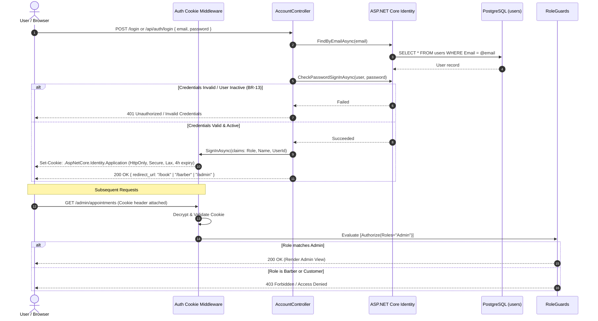
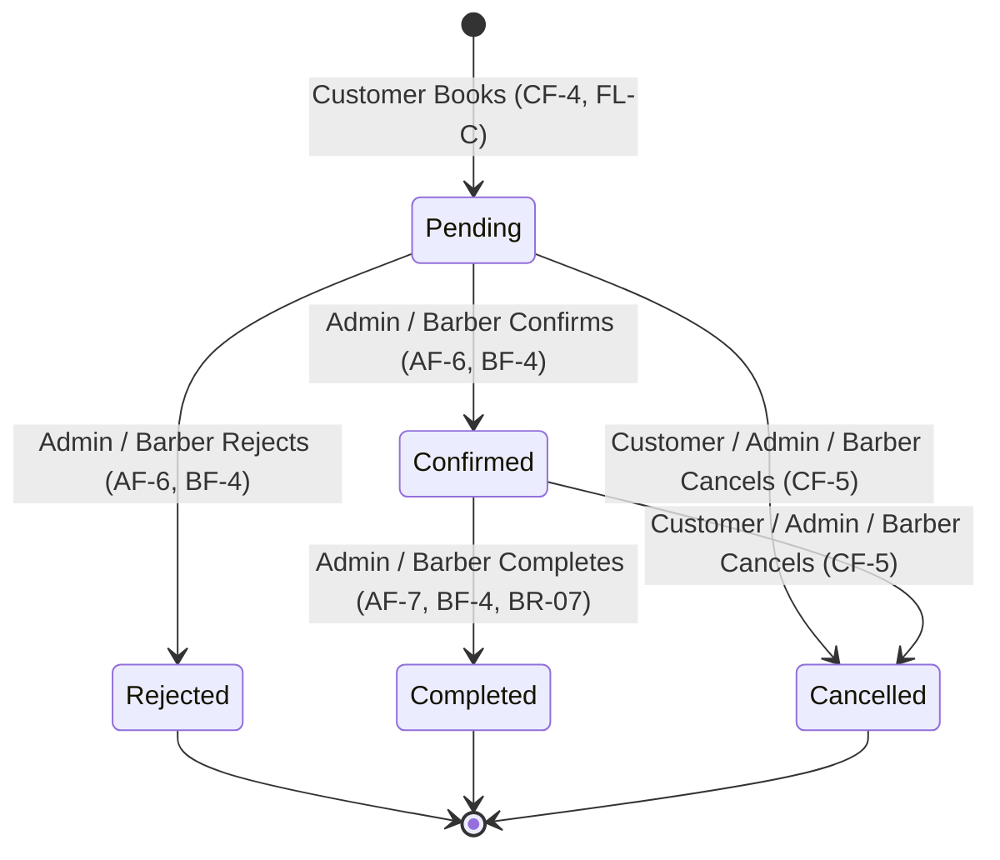

# BarberBook — System Architecture & Technical Specifications

> **Barber Shop Management System** · SBIT-3D, Group 4  
> Single Source of Truth Reference: [`BARBERBOOK_REFERENCE.md`](BARBERBOOK_REFERENCE.md)

---

## 1. High-Level Architecture

BarberBook is a monolithic ASP.NET Core 8 MVC application backed by PostgreSQL. The system uses server-rendered Razor Views with client-side interactive enhancements, styled via Tailwind CSS, and coordinates business workflows through modular service layers.

```mermaid
graph TD
    subgraph Client ["Client Browser / Mobile Viewport (375px+)"]
        UI_Customer["Customer Portal (/book, /my-appointments, /profile)"]
        UI_Barber["Barber Portal (/barber/schedule, /barber/transactions)"]
        UI_Admin["Admin Dashboard (/admin, /admin/inventory, /admin/reports)"]
    end

    subgraph Server ["ASP.NET Core 8 Web Application (Kestrel)"]
        subgraph Pipeline ["Security & Request Pipeline"]
            SecHeaders["SecurityHeadersMiddleware\n(HSTS, CSP, X-Frame-Options, X-Content-Type)"]
            RateLimiter["RateLimiter (Fixed-Window 15 req/min)"]
            AuthCookie["ASP.NET Core Identity Cookie Authentication"]
            RoleGuards["Role-Based Policies ([Authorize(Roles='Admin|Barber|Customer')])"]
            ErrHandler["ApiExceptionMiddleware (Consistent { error } JSON / Friendly Views)"]
        end

        subgraph Presentation ["Controllers & Endpoints"]
            Ctrl_Cust["Customer Controllers (Booking, Profile, Account)"]
            Ctrl_Barber["Barber Area Controllers (Dashboard, Schedule)"]
            Ctrl_Admin["Admin Area Controllers (Barbers, Services, Inventory, Reports)"]
            API_Endpoints["RESTful API Endpoints (/api/appointments, /api/inventory)"]
        end

        subgraph Services ["Application Business Services"]
            Svc_Avail["AvailabilityService\n(Dynamic 30m slots, Barber Schedule, Days Off)"]
            Svc_Trans["AppointmentTransitionService\n(State Machine Matrix §9, Status History Audit)"]
            Svc_Rep["ReportingService\n(Asia/Manila Financial Journals, Daily & Monthly)"]
            Svc_Inv["InventoryService\n(Derived Stock Movements, Products & Equipment)"]
            Svc_Equip["EquipmentService\n(Barber Assignments, Inspections, Quality Monitoring)"]
            Svc_PurSale["PurchaseSaleService\n(Supplier Purchases, Shop Product Sales)"]
        end

        subgraph Data ["Data Access Layer (EF Core + NodaTime)"]
            DbContext["BarberBookDbContext"]
            IdentityStores["ASP.NET Core Identity Stores"]
        end
    end

    subgraph Database ["PostgreSQL 16 Database"]
        PG_Tables["Relational Tables\n(users, barbers, services, appointments,\nproducts, stock_movements, equipment, purchases, product_sales)"]
        PG_Constraints["Database Constraints\n(GiST Exclusion Overlaps, Partial Unique Indexes,\nSELECT FOR UPDATE Row Locks, Advisory Xact Locks)"]
    end

    Client --> Pipeline
    Pipeline --> Presentation
    Presentation --> Services
    Services --> Data
    Data --> Database
```



---

## 2. Layered Structure & Core Components

### 2.1 Web Presentation Layer (`src/BarberBook.Web`)
- **Areas**:
  - `Admin`: Executive dashboard, barber account management, service catalog, inventory & equipment monitoring, financial reports (`RP-1`..`RP-4`).
  - `Barber`: Craftsman dashboard, Day & Week schedule views, status actions, weekly availability editor, days off manager, personal completed transactions (`BF-1`..`BF-6`).
  - `Customer` (Root): Public landing page, service & barber browsing, real-time booking wizard (`FL-C`), appointment rescheduling & cancellation, transaction history.
- **API Endpoints**:
  - RESTful JSON endpoints prefixed with `/api/` returning standardized error envelopes:
    ```json
    {
      "error": {
        "code": "SLOT_TAKEN",
        "message": "The selected barber is no longer available at this time.",
        "details": null
      }
    }
    ```
- **Shared Design System**:
  - Classic Vintage-Modern Barbershop theme (`#FBF7EE` Warm Cream, `#0F172A` Slate Dark Leather, `#B4832C` Whiskey Gold).
  - Consolidated UI partials: `_StatusBadge.cshtml`, `_Toast.cshtml`, `_ConfirmDialog.cshtml`, `_EmptyState.cshtml`, `_ErrorState.cshtml`.
  - Accessible, WCAG AA compliant, mobile-first responsive layout down to 375 px with zero horizontal scroll.

### 2.2 Domain & Application Services (`src/BarberBook.Web/Services`)
1. **`IAvailabilityService` / `AvailabilityService`**:
   - Calculates real-time 30-minute booking slots dynamically without caching (BR-04).
   - Evaluates weekly working hours, days off, existing non-cancelled bookings, and shop operating windows (9:00 AM – 5:00 PM).
2. **`IAppointmentTransitionService` / `AppointmentTransitionService`**:
   - Enforces the strict appointment status transition matrix defined in §9 of `BARBERBOOK_REFERENCE.md`.
   - Records every state change to the `status_history` audit trail with timestamp, user ID, and transition notes.
3. **`IReportingService` / `ReportingService`**:
   - Computes financial totals exclusively from completed appointments (BR-07, BR-11).
   - Adheres to exact Asia/Manila calendar date grouping and decimal PHP currency formatting (`₱1,340.00`).
   - Guarantees `Month Total == Sum(Daily Totals)`.
4. **`IInventoryService` / `InventoryService`**:
   - Dynamically derives product current stock from `stock_movements` (purchases, sales, adjustments).
   - Rejects negative stock adjustments (INV-03) and mandates documented adjustment reasons.
5. **`IEquipmentService` / `EquipmentService`**:
   - Manages barber equipment assignments and historical tracking.
   - Computes automated quality monitoring tiers: *Poor*, *Under Maintenance*, *Overdue for Inspection*, and *Healthy*.
6. **`IPurchaseSaleService` / `PurchaseSaleService`**:
   - Handles supplier stock purchases and counter retail product sales.
   - Employs `SELECT FOR UPDATE` product row locking to prevent overselling race conditions.

### 2.3 Data Persistence Layer (`src/BarberBook.Data`)
- **Technology**: Entity Framework Core 8 with `Npgsql.EntityFrameworkCore.PostgreSQL` and `Npgsql.EntityFrameworkCore.PostgreSQL.NodaTime`.
- **Timezone Management**: UTC timestamps in PostgreSQL `timestamp with time zone`; business logic and display in Asia/Manila (`ZonedDateTime`, `LocalDate`, `LocalTime`).
- **Data Integrity Constraints**:
  - Exclusion constraint on overlapping appointments (GiST).
  - Partial unique index on active equipment assignments: `equipment_assignments(equipment_id) WHERE returned_at IS NULL`.
  - Unique asset tags and SKUs.
  - Soft-deactivation flags (`is_active`, `retired_at`) preventing hard deletion (BR-13).

---

## 3. Authentication & Authorization Flow



---

## 4. State Machines & Concurrency Controls

### 4.1 Appointment State Transitions (§9 Oracle)
- `pending`: -> `confirmed`, `rejected`, `cancelled`
- `confirmed`: -> `completed`, `cancelled`
- `rejected`: Terminal state (immutable)
- `completed`: Terminal state (immutable, recorded in sales)
- `cancelled`: Terminal state (immutable)



### 4.2 Concurrency Safeguards
1. **Advisory Transaction Locks**:
   - `SELECT pg_advisory_xact_lock(barber_id)` executed during appointment creation prevents simultaneous overlapping bookings for the same barber.
2. **Pessimistic Product Row Locks**:
   - `SELECT * FROM products WHERE id = @id FOR UPDATE` during product counter sales ensures derived stock is validated and deducted atomically, returning `409 INSUFFICIENT_STOCK` if stock is exhausted.
3. **GiST Exclusion Constraints**:
   - Database-level safety net preventing temporal appointment overlaps in PostgreSQL.

