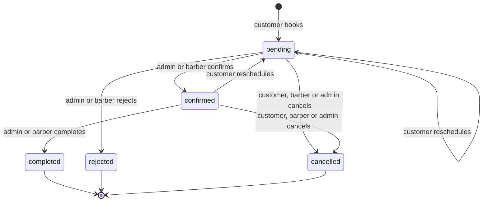
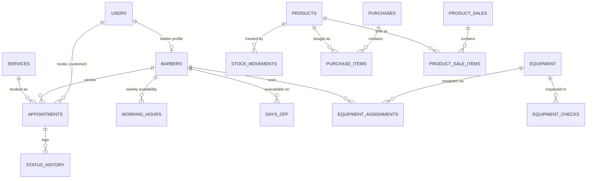
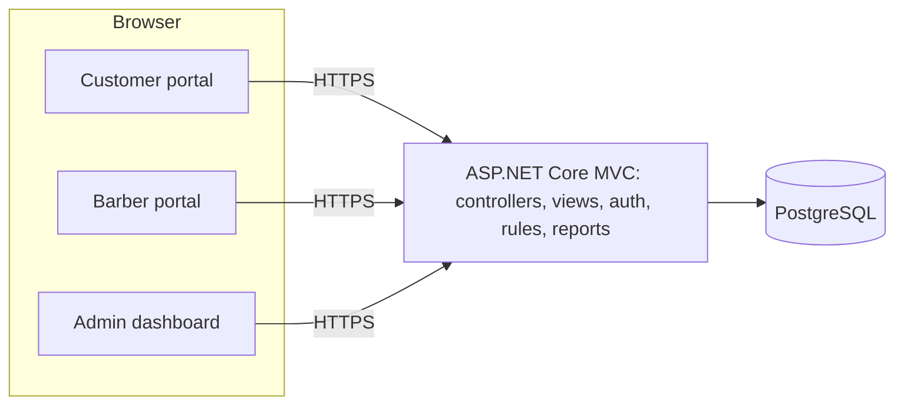

# BarberBook — Project Reference

**Barber Shop ~~Appointment~~ Management System**

Single source of truth for building BarberBook. Derived from the printed *Project Proposal* (Group 4, SBIT-3D, dated 10/23/2026) and the handwritten additions on its cover page.

| | |
|---|---|
| **Sources** | `GROUP-4.pdf` (printed proposal) · photo of the cover page with handwritten additions (signed, dated 10/23/26) |
| **How to use** | Commit as `docs/BARBERBOOK_REFERENCE.md`. Cite requirement IDs (`CF-4`, `BR-03`, `HW-2`…) in prompts, tests and commits. |
| **Companion file** | `BARBERBOOK_PROMPT_PLAN.md` — the ordered prompts that build everything described here |

## Contents

1. [Reading guide](#1-reading-guide)
2. [Project snapshot](#2-project-snapshot)
3. [Cover page and handwritten additions](#3-cover-page-and-handwritten-additions)
4. [Problem and objectives](#4-problem-and-objectives)
5. [Scope and limitations](#5-scope-and-limitations)
6. [System description: roles, interfaces and features](#6-system-description-roles-interfaces-and-features)
7. [Sales reports and transaction records](#7-sales-reports-and-transaction-records)
8. [System flows](#8-system-flows)
9. [Appointment lifecycle](#9-appointment-lifecycle)
10. [Business rules](#10-business-rules)
11. [Data model](#11-data-model)
12. [Screens and navigation](#12-screens-and-navigation)
13. [Technology stack](#13-technology-stack)
14. [Expected output and benefits](#14-expected-output-and-benefits)
15. [Acceptance tests](#15-acceptance-tests)
16. [Assumptions and open questions](#16-assumptions-and-open-questions)
17. [Traceability matrix](#17-traceability-matrix)
18. [Appendix](#18-appendix)

---

## 1. Reading guide

Every statement carries a source tag so nothing invented is mistaken for the paper.

| Tag | Meaning | Authority |
|---|---|---|
| **[P]** | Stated in the printed proposal | Highest — never change without the adviser |
| **[H]** | Handwritten addition on the cover page | Highest — signed change (see §3) |
| **[A]** | Assumption or design decision added so the system can be built | Lowest — logged in §16; change freely if the paper or adviser disagrees |

**Conflict rule:** [P] and [H] override [A]. If building exposes a conflict, change the [A] item and log it in `docs/DECISIONS.md`.

**ID prefixes:** `PS` problem statement · `OB` objective · `SC` scope · `LM` limitation · `CF` customer feature · `AF` admin feature · `BF` barber feature · `RP` report · `FL` flow · `EO` expected output · `HW` handwritten addition · `BR` business rule · `INV` inventory rule · `AS` assumption · `T` acceptance test.

---

## 2. Project snapshot

| | |
|---|---|
| **Name** | BarberBook |
| **Type** | Web-based application |
| **Title** | Barber Shop ~~Appointment~~ Management System **[H]** (printed title: "Barber Shop Appointment Management System") |
| **Users** | Three roles: **Customer**, **Barber**, **Admin** **[P]** |
| **Interfaces** | (1) customer-facing booking portal, (2) barber portal for one's own schedule and appointments, (3) admin management dashboard **[P]** |
| **Core idea** | Centralize all scheduling so availability is always accurate and up to date for customers, barbers and the shop administrator; generate sales automatically from completed appointments **[P]** |
| **Adviser additions** | Equipment per barber and inventory management · product sales (buy and sell) · equipment quality monitoring **[H]** |
| **Hard boundaries** | No online payment gateway · not a full accounting/POS system · single shop or small chain · barbers cannot self-register · SMS/email are optional extras **[P]** |
| **Currency and time** | Philippine peso (₱) and 12-hour times such as "9:00 AM" **[P]** (sample reports); shop time zone Asia/Manila **[A]** |

**Summary.** Barber shops that book by phone, text or walk-in suffer double bookings, long waits and scattered records. BarberBook lets customers browse services and barbers, check real-time availability and book online; gives barbers their own account to manage schedule, availability, days off and appointment status; and gives administrators a dashboard to manage appointments, services and prices, barber accounts and schedules, and customer records, and to read daily and monthly sales and transaction records computed automatically from completed appointments. The handwritten additions extend the system from appointments only to whole-shop management: equipment assigned per barber, inventory, product sales (buying stock and selling products) and equipment quality monitoring.

---

## 3. Cover page and handwritten additions

### 3.1 Printed cover **[P]**
Project Proposal · **BarberBook** · Barber Shop Appointment Management System · Submitted by [GROUP 4], SBIT-3D · Submitted to Emmanuel Alarilla · Date 10/23/2026.

### 3.2 Handwritten changes **[H]**
Signed and dated 10/23/26. They are treated here as approved changes from the person the proposal was submitted to (confirm this).

| ID | As written | What it means for the system |
|---|---|---|
| **HW-0** | "Appointment" struck out in the subtitle → *Barber Shop Management System* | Scope widens from appointments only to whole-shop management. The product name stays **BarberBook**. The printed pages still say "Appointment" — update the title and introduction when revising the paper. |
| **HW-1** | "1. Equipment per Barber, Inventory management" | Track equipment (clippers, trimmers, scissors, razors, chairs…) and which barber each item is assigned to; manage inventory of equipment and retail products. |
| **HW-2** | "2. Product sales, Buy and Sell" | The shop **buys** stock (purchases, restocking) and **sells** products to customers; stock levels follow both; product sales are visible in the sales dashboards. |
| **HW-3** | "3. Equipment Quality Monitoring" | Record inspections and condition of equipment over time; flag items in poor condition, out of service or overdue for inspection. |

### 3.3 How the additions interact with the printed paper

| Printed statement | Effect of the additions |
|---|---|
| **LM-1** No online payment gateway; payments settled in-shop | **Still holds.** Product sales are recorded after in-shop payment; nothing is charged online. |
| **LM-2** Not a full accounting or POS system | **Still holds.** Product sales and purchases are lightweight record keeping: no receipt printing, tax handling, barcode scanning, cash drawer or general ledger. |
| **LM-4** Barbers access only their own schedule, appointments and transactions | **Extended [A]:** barbers can also see the equipment assigned to them and log a quality check on it (AS-04). Barbers cannot see inventory, purchases or product sales. |
| §3 Objectives and §4 Scope do not mention the additions | The additions are tracked here as `HW-1…HW-3`. Suggested wording for the paper is in [Appendix B](#appendix-b--suggested-amendments-to-the-paper). |

---

## 4. Problem and objectives

### 4.1 Problem statement **[P]**
Shops that rely on manual or informal appointment methods commonly face:

| ID | Problem |
|---|---|
| PS-1 | Appointments are booked by phone call, text message or in person, making it difficult to track availability in real time. |
| PS-2 | Double bookings and scheduling conflicts occur because there is no centralized, up-to-date schedule. |
| PS-3 | Customers have no convenient way to check a barber's availability before visiting the shop. |
| PS-4 | Shop staff spend significant time manually organizing appointments, service records and customer information. |
| PS-5 | There is no easy way to track appointment history, cancellations or no-shows for reporting and decision-making. |

### 4.2 General objective **[P]**
To design and develop BarberBook, a web-based Barber Shop Appointment Management System that simplifies the scheduling and management of customer appointments for barber shops. *(The title now reads "Management System" per HW-0.)*

### 4.3 Specific objectives **[P]**

| ID | Objective |
|---|---|
| OB-1 | Allow customers to register, log in, and view available barber services and barber profiles. |
| OB-2 | Provide online booking where customers select a service, barber, date and time based on real-time availability. |
| OB-3 | Implement appointment confirmation, cancellation and rescheduling for customers. |
| OB-4 | Create an admin dashboard for managing appointments, services, barber accounts and schedules, and customer information. |
| OB-5 | Enable administrators to confirm, reject and update the status of appointments, and allow barbers to update the status of their own appointments. |
| OB-6 | Provide a barber account, created by the administrator, that lets barbers log in to view their own schedule and appointments, set their availability or day off, and view their own transactions. |
| OB-7 | Provide a means of viewing appointment history for reporting and record keeping. |
| OB-8 | Provide daily sales and monthly sales reports, together with customer and barber transaction records, on the admin dashboard, based on completed appointments and service prices. |

---

## 5. Scope and limitations

### 5.1 Scope

| ID | In scope | Source |
|---|---|---|
| SC-1 | Customer registration, login and profile management | [P] |
| SC-2 | Browsing available services and barber profiles/schedules | [P] |
| SC-3 | Online appointment booking with date and time selection | [P] |
| SC-4 | Appointment confirmation, cancellation and rescheduling by customers | [P] |
| SC-5 | Admin dashboard for managing services, prices, barber accounts, barber schedules and customer records | [P] |
| SC-6 | Barber account (created by the administrator) with login, own schedule and appointments, availability or day off, and own transactions | [P] |
| SC-7 | Appointment status updates (e.g. pending, confirmed, completed, cancelled) by administrators and by barbers for their own appointments | [P] |
| SC-8 | Viewing appointment history by both customers and administrators | [P] |
| SC-9 | Daily and monthly sales reports, and customer and barber transactions, on the admin dashboard, computed from completed appointments and service prices | [P] |
| SC-10 | Equipment per barber and inventory management (HW-1) | [H] |
| SC-11 | Product sales: buying (restocking) and selling products (HW-2) | [H] |
| SC-12 | Equipment quality monitoring (HW-3) | [H] |

### 5.2 Limitations **[P]**

| ID | Limitation | Build consequence |
|---|---|---|
| LM-1 | No online payment gateway; payments are assumed to be settled in-shop unless a future enhancement adds one | No card or e-wallet code, no payment SDKs |
| LM-2 | Sales and transaction records come from completed appointments and listed service prices; not a full accounting or POS system | Reports are read-only views over appointment data (plus lightweight product sales per HW-2) |
| LM-3 | Designed for a single barber shop or a small chain; not a multi-tenant, multi-branch franchise platform | One shop; no tenant or branch model |
| LM-4 | Barbers cannot register themselves; admins create barber accounts; barbers can only access their own schedule, appointments and transactions | No barber sign-up route; every barber query is scoped to the logged-in barber |
| LM-5 | SMS or email notifications are optional enhancements, not core | No notification code in the core build |
| LM-6 | Depends on administrators and barbers keeping schedules updated; does not detect real-world availability outside the system | No automatic availability detection |

### 5.3 Significance **[P]**
Shop owners/administrators (less manual work; decisions backed by appointment history and daily/monthly sales) · Barbers (a clear, centralized schedule without conflicting bookings) · Customers (book, reschedule or cancel without calling or visiting) · Future researchers/developers (a reference for appointment systems in other service industries).

---

## 6. System description: roles, interfaces and features

### 6.1 Roles and interfaces **[P]**

| Role | Interface | How the account is created | Can access |
|---|---|---|---|
| Customer | Customer-facing booking portal | Self-registers | Own profile, own appointments and history; public browsing |
| Barber | Barber portal | **Created by the admin** (LM-4) | Only own schedule, appointments and transactions (plus own equipment, AS-04) |
| Admin | Admin management dashboard | Seeded **[A]** | Everything |

### 6.2 Customer features **[P]**

| ID | Feature |
|---|---|
| CF-1 | Customer registration and login |
| CF-2 | View available barber services |
| CF-3 | View barber profiles and schedules |
| CF-4 | Online appointment booking (select service, barber, date and time) |
| CF-5 | Appointment confirmation |
| CF-6 | Cancel or reschedule an appointment |

*CF-5 is delivered twice: the booking confirmation page that ends the customer flow (FL-C), and the `confirmed` status that the shop sets (OB-5), which the customer sees in "My appointments".*

### 6.3 Admin features **[P]**

| ID | Feature |
|---|---|
| AF-1 | Admin dashboard |
| AF-2 | Create and manage barber accounts |
| AF-3 | Manage services and prices |
| AF-4 | Manage barber schedules |
| AF-5 | Manage customer information |
| AF-6 | Update appointment status (confirm, reject, complete, cancel) |
| AF-7 | View appointment history |
| AF-8 | View daily sales, monthly sales, and customer and barber transactions (§7) |

### 6.4 Barber features **[P]**

| ID | Feature |
|---|---|
| BF-1 | Log in using an account created by the administrator |
| BF-2 | View own schedule and appointments |
| BF-3 | Set availability and day off |
| BF-4 | Update the status of own appointments |
| BF-5 | View own transactions |

### 6.5 Shop-management features from the handwritten additions **[H]**

| ID | Feature | From |
|---|---|---|
| AF-9 | Manage equipment records and assign equipment to barbers (equipment per barber) | HW-1 |
| AF-10 | Manage inventory: retail products and stock levels, with manual adjustments | HW-1 |
| AF-11 | Record purchases (buy / restock) that increase stock | HW-2 |
| AF-12 | Record product sales (sell) that decrease stock; view product sales history | HW-2 |
| AF-13 | Monitor equipment quality: inspection log, current condition, overdue and poor-condition alerts | HW-3 |
| BF-6 **[A]** | See own assigned equipment and log a quality check on it | HW-1, HW-3, AS-04 |

### 6.6 Permission matrix **[A]** (derived from §6.1–§6.5)

| Capability | Customer | Barber | Admin |
|---|:--:|:--:|:--:|
| Register | ✔ | ✘ | ✘ |
| Log in | ✔ | ✔ | ✔ |
| Browse services, barbers, schedules | ✔ | ✔ | ✔ |
| Book an appointment | ✔ own | ✘ | ✘ |
| Reschedule an appointment | ✔ own | ✘ | ✘ |
| Cancel an appointment | ✔ own | ✔ own appointments | ✔ any |
| Confirm / reject / complete | ✘ | ✔ own appointments | ✔ any |
| View appointment history | ✔ own | ✔ own | ✔ all |
| Manage barber accounts, services, prices | ✘ | ✘ | ✔ |
| Manage barber schedules | ✘ | ✔ own availability and days off | ✔ all |
| Manage customers | ✘ (own profile only) | ✘ | ✔ |
| Daily and monthly sales, customer transactions | ✘ | ✘ | ✔ |
| Barber transactions | ✘ | ✔ own | ✔ all |
| Equipment: manage and assign | ✘ | ✘ | ✔ |
| Equipment: view and log checks | ✘ | ✔ own assigned | ✔ all |
| Inventory, purchases, product sales | ✘ | ✘ | ✔ |

---

## 7. Sales reports and transaction records

### 7.1 The four reports **[P]**
Sales and transactions are generated automatically from appointments marked **completed** and the service prices set by the administrator, so no separate encoding is needed. Payments are still settled in-shop.

| ID | Report | What the dashboard shows | Computed from |
|---|---|---|---|
| RP-1 | **Daily Sales** | Total sales for the day, number of completed appointments, sales per service and per barber | Completed appointments of the day × service prices |
| RP-2 | **Monthly Sales** | Total sales for the month, day-by-day totals, sales per service and per barber | Sum of the daily sales for the month |
| RP-3 | **Customer Transactions** | Each customer's transaction history: date, service availed, barber, amount; viewable per customer | Completed appointments of each customer |
| RP-4 | **Barber Transactions** | Each barber's transaction history: date, customer served, service performed, amount, with the barber's total sales | Completed appointments of each barber |

### 7.2 Calculation rules **[A]** (make the paper's formulas precise)
- Only `completed` appointments count (BR-07). Pending, confirmed, rejected and cancelled never do.
- **Amount** = the price stored on the appointment when it was booked (BR-08), so later price edits do not rewrite history.
- A sale belongs to the appointment's **scheduled date in Asia/Manila time** (BR-11).
- Money is shown as `₱1,340.00`.
- Product sales (HW-2) are reported **separately** from service sales; *Grand total = service sales + product sales*. The paper's service figures never change because of product sales (INV-06).

### 7.3 Sample data from the paper — seed data and test oracle **[P]**

**Services and prices (as they appear in the samples)**

| Service | Price (₱) | Duration **[A]** |
|---|--:|--:|
| Haircut | 150.00 | 30 min |
| Haircut + Shave | 220.00 | 60 min |
| Beard Trim | 100.00 | 30 min |
| Hair Color | 500.00 | 90 min |

**Barbers:** Ramon, Dennis, Miguel. **Customers:** Juan Dela Cruz, Mark Santos, Paolo Reyes, Carlo Mendoza, Adrian Cruz, Leo Garcia.

**Daily Sales Report — September 14, 2026**

| No. | Time | Customer | Barber | Service | Amount (₱) |
|--:|---|---|---|---|--:|
| 1 | 9:00 AM | Juan Dela Cruz | Ramon | Haircut | 150.00 |
| 2 | 10:00 AM | Mark Santos | Dennis | Haircut + Shave | 220.00 |
| 3 | 11:30 AM | Paolo Reyes | Ramon | Beard Trim | 100.00 |
| 4 | 1:00 PM | Carlo Mendoza | Miguel | Haircut | 150.00 |
| 5 | 2:30 PM | Adrian Cruz | Dennis | Hair Color | 500.00 |
| 6 | 4:00 PM | Leo Garcia | Miguel | Haircut + Shave | 220.00 |
| | | | | **Total Sales** | **1,340.00** |

**Customer Transaction Record — Juan Dela Cruz**

| Date | Service | Barber | Status | Amount (₱) |
|---|---|---|---|--:|
| Sep 14, 2026 | Haircut | Ramon | Completed | 150.00 |
| Aug 30, 2026 | Haircut + Shave | Dennis | Completed | 220.00 |
| Aug 16, 2026 | Haircut | Ramon | Completed | 150.00 |
| | | | **Total Spent** | **520.00** |

**Derived expected values** (calculated from the paper's samples; tests must match)

| Check | Expected |
|---|---|
| Daily total, 2026-09-14 | 6 completed appointments · ₱1,340.00 |
| Per barber, 2026-09-14 | Ramon ₱250.00 (2) · Dennis ₱720.00 (2) · Miguel ₱370.00 (2) |
| Per service, 2026-09-14 | Haircut ₱300.00 (2) · Haircut + Shave ₱440.00 (2) · Beard Trim ₱100.00 (1) · Hair Color ₱500.00 (1) |
| Customer total, Juan Dela Cruz | ₱520.00 (3 transactions) |
| Monthly total, seed data only | Sep 2026 = ₱1,340.00 · Aug 2026 = ₱370.00 (the seed contains no other completed appointments) |

---

## 8. System flows **[P]**

### 8.1 Customer flow (FL-C)

### 8.2 Admin flow (FL-A)

### 8.3 Barber flow (FL-B)

**Extension for the additions [H]:** Admin → Inventory → Buy (purchase) / Sell (product sale) / Equipment → Assign to barber → Log inspection.

---

## 9. Appointment lifecycle

**Statuses [P]:** `pending`, `confirmed`, `completed`, `cancelled` (SC-7), plus `rejected` (AF-6, "reject").

**Transition table [A]** — statuses are [P]; who may do what is derived from OB-3, OB-5 and BF-4.

| Transition | Customer (own) | Barber (own appointments) | Admin |
|---|:--:|:--:|:--:|
| *(new)* → pending | ✔ books | ✘ | ✘ |
| pending → confirmed | ✘ | ✔ | ✔ |
| pending → rejected | ✘ | ✔ | ✔ |
| pending or confirmed → cancelled | ✔ | ✔ | ✔ |
| confirmed → completed | ✘ | ✔ | ✔ |
| pending or confirmed → pending (reschedule) | ✔ | ✘ | ✘ |
| completed, rejected, cancelled → anything | ✘ terminal | ✘ | ✘ |

Every change writes a row to `status_history` (who, from, to, when, optional note); that log is the "appointment history" of OB-7. Slots are blocked by `pending`, `confirmed` and `completed` appointments only.

---

## 10. Business rules

### 10.1 Core rules

| ID | Rule | Source |
|---|---|---|
| BR-01 | Exactly three roles exist: customer, barber, admin. Customers self-register; barber accounts are created only by an admin; admin accounts are seeded. | [P] LM-4 · [A] seeding |
| BR-02 | Authorization is enforced on the server for every route. A barber reads and writes only their own schedule, appointments and transactions (and equipment, AS-04). A customer reads and writes only their own data. | [P] LM-4 |
| BR-03 | **No double booking.** A booking is accepted only if the slot lies inside the barber's working hours, is not on a day off, is in the future, and does not overlap another `pending`, `confirmed` or `completed` appointment of the same barber. Enforced in application logic **and** by a database constraint, inside a transaction. | [P] PS-2, OB-2 · [A] mechanics |
| BR-04 | Availability is computed live from working hours, days off and existing appointments (no cached slot lists), so customers always see real-time availability. | [P] OB-2 |
| BR-05 | Slots start on a 30-minute grid. An appointment occupies `service.duration_minutes` from its start. Default durations: Haircut 30, Haircut + Shave 60, Beard Trim 30, Hair Color 90 (admin-editable). | [A] — grid inferred from the sample times 9:00, 10:00, 11:30, 1:00, 2:30, 4:00 |
| BR-06 | Status changes follow §9; invalid transitions are rejected; every change is logged. | [P] statuses · [A] rules |
| BR-07 | Only `completed` appointments count toward sales and transactions. | [P] §6.4 |
| BR-08 | An appointment stores `price` and `service_name` at booking time; reports use these snapshots. | [A] |
| BR-09 | Customers may cancel or reschedule their own `pending` or `confirmed` appointments. A reschedule is validated exactly like a new booking (excluding the appointment itself), changes date and time only, and returns the appointment to `pending`. No cancellation cut-off or fee (the paper is silent). | [P] CF-6 · [A] details |
| BR-10 | Appointment history lists every status. Customers see their own; admins see all, filterable by date, status, barber, customer and service. | [P] OB-7, SC-8 |
| BR-11 | A sale's date is the appointment's scheduled date in Asia/Manila. Monthly sales = the sum of the month's daily sales, with day-by-day totals shown. | [P] §6.4 · [A] time zone |
| BR-12 | Customer transactions = completed appointments of that customer (date, service, barber, amount) plus total spent. Barber transactions = completed appointments of that barber (date, customer, service, amount) plus total sales. | [P] §6.4 |
| BR-13 | Nothing is hard-deleted. Users, barbers, services and products are **deactivated**. Deactivated barbers, services and products disappear from booking and selling but stay in history. Deactivated customers cannot log in or book. | [A] |
| BR-14 | A service price change never alters existing appointments (BR-08). | [A] |
| BR-15 | Browsing services, barbers and schedules is public; booking and "My appointments" require a customer login. | [A] — the paper's flow starts at Login/Register |
| BR-16 | Money is stored exactly (decimal or integer centavos), never as floating point. | [A] |
| BR-17 | Passwords are hashed, sessions use httpOnly cookies and all input is validated on the server. There is no email-based password reset in the core (LM-5); an admin resets passwords. | [A] security baseline |
| BR-18 | Any barber can perform any service. | [A] — the paper has no barber-to-service mapping |

### 10.2 Inventory rules **[H]/[A]**

| ID | Rule |
|---|---|
| INV-01 | A piece of equipment has at most one active assignment (one barber at a time). Assignment history is kept; unassigned equipment belongs to the shop. |
| INV-02 | Equipment condition = the latest inspection (`excellent`, `good`, `fair`, `poor`). Each item has an inspection interval (default 30 days). An item is **flagged** when its condition is `poor`, its status is `under_maintenance` or `out_of_service`, or its next inspection is overdue. |
| INV-03 | Product stock = the sum of stock movements (purchase +, sale −, adjustment ±). Stock cannot go negative: a sale larger than the stock is refused. |
| INV-04 | **Buy:** a purchase records supplier, date, items, quantities and unit costs and adds stock. **Sell:** a product sale records items, quantities and the unit price at sale time and removes stock. Manual adjustments are admin-only and need a reason. |
| INV-05 | A product is **low stock** when stock ≤ its reorder level. |
| INV-06 | Product sales are shown separately from service sales in the daily and monthly sales views; the service totals defined by the paper are unaffected. |
| INV-07 | Barbers can view only equipment currently assigned to them and log inspections on it. Customers have no access. |

---

## 11. Data model **[A]**

Derived from the paper's features — the paper itself does not define tables. Names are suggestions; keep the relationships and constraints.

### 11.1 Core entities (from the printed paper)

| Table | Key columns | Constraints and notes |
|---|---|---|
| `users` | id, role (`customer` / `barber` / `admin`), full_name, email, phone, password_hash, is_active, created_at | Unique email. One table for all three roles. |
| `barbers` | id, user_id, display_name, bio, photo_url, specialties, is_active | One-to-one with a `users` row whose role is `barber`. Shown to customers (CF-3). |
| `services` | id, name, description, price, duration_minutes, is_active | Price ≥ 0; duration is a multiple of 30. |
| `working_hours` | id, barber_id, weekday (0–6), start_time, end_time | Weekly recurring availability; several ranges per day allowed; no overlap within a day. |
| `days_off` | id, barber_id, date, reason | Unique (barber_id, date). |
| `appointments` | id, reference_code, customer_id, barber_id, service_id, starts_at, ends_at, status, price, service_name, notes, created_at, updated_at | `ends_at > starts_at`. **Exclusion constraint:** no two rows of the same barber with overlapping time ranges while status is `pending`, `confirmed` or `completed`. Unique reference code such as `BB-20260914-0001`. |
| `status_history` | id, appointment_id, from_status, to_status, changed_by, changed_by_role, note, changed_at | Append-only. |

### 11.2 Shop-management entities (from the handwritten additions)

| Table | Key columns | Constraints and notes |
|---|---|---|
| `equipment` | id, asset_tag, name, category, brand_model, serial_no, purchase_date, purchase_cost, condition, status (`in_service` / `under_maintenance` / `out_of_service` / `retired`), inspection_interval_days, notes | Unique asset_tag. Retire instead of delete. |
| `equipment_assignments` | id, equipment_id, barber_id, assigned_at, returned_at, notes | Partial unique index: one row per equipment where `returned_at` is null. |
| `equipment_checks` | id, equipment_id, checked_by, checked_at, condition, notes, next_check_due | The latest check updates `equipment.condition`. |
| `products` | id, sku, name, category, unit, sell_price, cost_price, reorder_level, is_active | Unique sku. Stock is derived from movements, never typed in directly. |
| `stock_movements` | id, product_id, type (`purchase` / `sale` / `adjustment`), quantity (signed), unit_amount, ref_type, ref_id, reason, created_by, created_at | Append-only. |
| `purchases`, `purchase_items` | supplier_name, purchased_at, notes, created_by · product_id, quantity, unit_cost | "Buy". Creates `purchase` movements. |
| `product_sales`, `product_sale_items` | sold_at, customer_id (optional), appointment_id (optional), notes, recorded_by · product_id, quantity, unit_price, line_total | "Sell". Creates `sale` movements. The unit price is a snapshot. |

---

## 12. Screens and navigation **[A]**

**Customer portal** — Home · Services · Barbers · Barber profile (bio, weekly schedule, days off) · Register · Login · Book (wizard: Service → Barber → Date & Time → Review → Confirmation) · My appointments (Upcoming / History, cancel, reschedule) · My profile.

**Barber portal** — Login · Dashboard (today) · My schedule (**day and week** views) · Appointment detail with status actions · Availability and days off · My transactions (with total sales) · My equipment (HW-1, HW-3, AS-04).

**Admin dashboard**
- Dashboard — today's bookings, pending bookings needing action, today's and this month's sales, alerts (low stock, flagged equipment)
- Appointments (**list, day and week** views; confirm / reject / complete / cancel) · Appointment history
- Barber accounts · Barber schedules · Services and prices · Customers
- Reports — Daily Sales · Monthly Sales · Customer Transactions · Barber Transactions
- Inventory **[H]** — Products · Buy (Purchases) · Sell (Product sales) · Equipment · Equipment per barber · Equipment quality monitoring

EO-3 ("daily and weekly appointments") is why barber and admin views offer day and week layouts.

---

## 13. Technology stack

### 13.1 Options in the paper **[P]**

| Layer | Options |
|---|---|
| Front-end | HTML, CSS, JavaScript (or a framework such as React/Vue) |
| Back-end | PHP / Node.js / (framework to be finalized with the adviser/client) |
| Database | MySQL / PostgreSQL |

### 13.2 Stack Lock **[A]** — the choice used by the prompt plan
Every choice sits inside the paper's options. Confirm with the adviser/client. To switch stacks, edit this table and the `STACK LOCK` block in prompt P00.

| Layer | Choice | Why it fits the paper |
|---|---|---|
| Front-end | ASP.NET Core MVC Razor Views + Tailwind CSS | HTML/CSS/JS rendered server-side; "framework" option |
| Back-end | ASP.NET Core 8 MVC (C#) | "framework to be finalized with the adviser/client" |
| Database | PostgreSQL | "PostgreSQL"; native exclusion constraints make double-booking prevention airtight |
| Data access | Entity Framework Core (Npgsql) with hand-edited SQL migration for the exclusion constraint | — |
| Validation | Data Annotations + FluentValidation | — |
| Authentication | Email + password, ASP.NET Core Identity (built-in hashing + cookie auth), role-based [Authorize] | LM-4, BR-17 |
| Dates | NodaTime, shop time zone `Asia/Manila` | BR-11 |
| Tests | xUnit + WebApplicationFactory (unit/integration), Playwright (end-to-end) | — |
| Repository | One solution with `src/` (Web + Data) and `tests/` folders | Single deployable MVC app |

**Authentication flow:** login → ASP.NET Core Identity verifies the password hash → issues a cookie via `SignInManager.PasswordSignInAsync()` → every request passes `[Authorize]`, then role checks → controllers also scope data to the caller (barber ↔ own rows, customer ↔ own rows).

---

## 14. Expected output and benefits **[P]**

| ID | Expected output | Proven by |
|---|---|---|
| EO-1 | A fully functional web-based appointment booking system for barber shops | All acceptance tests |
| EO-2 | Reduced scheduling conflicts and double bookings | T-03, T-04 |
| EO-3 | Better organization of daily and weekly appointments for barbers and administrators | T-21 |
| EO-4 | A more convenient, accessible booking experience for customers | T-02, T-22 |
| EO-5 | Centralized records of services, prices, barber schedules and customer information | T-07, T-08, T-09 |
| EO-6 | Visible daily and monthly sales reports, plus customer and barber transaction records | T-10 – T-14 |
| EO-7 | A foundation that can be extended with online payments, SMS/email reminders and customer loyalty programs | Clean module boundaries; optional prompts X2–X4 |

---

## 15. Acceptance tests

Run against the seed data in §7.3 unless noted.

| ID | Scenario | Expected result | Covers |
|---|---|---|---|
| T-01 | A visitor registers, logs in, views services and barber profiles | Account created as `customer`; services and barbers listed | CF-1, CF-2, CF-3, OB-1 |
| T-02 | A customer books Haircut with Ramon at an open slot | Appointment is `pending`; the confirmation shows reference, service, barber, date and time (12-hour) and ₱ price | CF-4, CF-5, OB-2 |
| T-03 | Two customers book the same barber and slot at the same moment | Exactly one succeeds; the other gets a clear "slot taken" error | PS-2, BR-03, EO-2 |
| T-04 | The barber has a day off, or the time is outside working hours or in the past | No slots offered; a direct API booking is rejected | BF-3, BR-03 |
| T-05 | A customer cancels one appointment and reschedules another | Cancellation logged; the reschedule re-validates availability and returns to `pending` | CF-6, OB-3, BR-09 |
| T-06 | Admin confirms and rejects bookings; a barber updates their own; a barber tries another barber's | Allowed transitions are logged; the foreign appointment returns 403 | AF-6, BF-4, OB-5 |
| T-07 | Admin creates a barber account; the barber logs in; there is no barber sign-up | The barber sees only their own data; no self-registration route exists | AF-2, BF-1, LM-4, OB-6 |
| T-08 | A barber edits weekly hours and adds a day off | The booking UI reflects it immediately | BF-3, AF-4 |
| T-09 | A customer opens history; admin filters history by status, date, barber and customer | The customer sees only their own; admin sees all, with the status timeline | OB-7, SC-8, AF-7 |
| T-10 | Daily Sales for 2026-09-14 | 6 appointments · ₱1,340.00 · per-barber and per-service values as in §7.3 | RP-1, OB-8 |
| T-11 | Monthly Sales | Sep 2026 = ₱1,340.00 and Aug 2026 = ₱370.00 on seed data; day-by-day totals sum to the month; an appointment at 11:30 PM on the 30th and one at 12:30 AM on the 1st land in different months | RP-2, BR-11 |
| T-12 | Customer Transactions for Juan Dela Cruz | 3 rows (Sep 14, Aug 30, Aug 16) · Total Spent ₱520.00 | RP-3 |
| T-13 | Barber Transactions for Ramon (admin view and Ramon's own view) | Own completed appointments with total sales; another barber's rows never appear in Ramon's own view | RP-4, BF-5 |
| T-14 | Pending, confirmed, cancelled and rejected appointments exist on 2026-09-14 | None of them changes any total | BR-07 |
| T-15 | Inspect the code base | No payment-gateway code, no SMS/email sending, no barber sign-up route, no branch or tenant model | LM-1, LM-3, LM-4, LM-5 |
| T-16 | Admin assigns equipment to a barber, then reassigns it | One active assignment at a time; history kept; the barber sees only their own equipment | HW-1, INV-01, INV-07 |
| T-17 | An inspection records `poor`; another item passes its due date | Both are flagged on the equipment quality view and the admin dashboard | HW-3, INV-02 |
| T-18 | Purchase 10 units; sell 3; try to sell 20 | Stock goes 10 → 7; the 20-unit sale is refused; low-stock alert at or below the reorder level | HW-2, INV-03 – INV-05 |
| T-19 | Record a product sale on 2026-09-14 | Service total stays ₱1,340.00; product sales appear separately; grand total = both | HW-2, INV-06 |
| T-20 | Role guards: customer → barber and admin routes; barber → admin routes | 401/403 on every attempt (route-table test) | BR-02 |
| T-21 | Barber and admin schedule views | Day and week layouts available | EO-3 |
| T-22 | Complete the booking flow on a 375 px-wide viewport | Usable without horizontal scrolling | EO-4 |

---

## 16. Assumptions and open questions

### 16.1 Ask the adviser first

| ID | Question or assumption | Default used in the build |
|---|---|---|
| AS-01 | **"Buy and Sell" (HW-2):** does it mean the shop buys stock from suppliers and sells products to customers, or customers buying products online? | The shop buys (restocks) and sells (counter sales), recorded by an admin; payment in-shop; no online store (LM-1). A read-only customer product catalog is optional prompt X5. |
| AS-02 | **"Equipment per Barber, Inventory management" (HW-1):** one item (equipment inventory per barber) or two? | Both: equipment assigned per barber **and** inventory of retail products. |
| AS-03 | Are product sales and purchases part of the "sales" dashboards? | Shown separately beside service sales; grand total = both (INV-06). |
| AS-04 | May barbers see their own equipment and log checks (this extends LM-4)? | Yes: read-only plus "log a check" on own equipment. Drop BF-6 if the adviser says no. |
| AS-05 | PS-5 mentions **no-shows**, but no status exists for them | Not in the core; optional prompt X1 adds `no_show` (never counted in sales). |
| AS-06 | Is the stack in §13.2 acceptable? | Yes — all choices are inside the paper's options. |

### 16.2 Decisions made where the paper is silent

| ID | Decision | Rule |
|---|---|---|
| AS-07 | Rescheduling returns the appointment to `pending` for re-confirmation; only date and time change | BR-09 |
| AS-08 | `pending`, `confirmed` and `completed` appointments block a slot | BR-03 |
| AS-09 | 30-minute slot grid; service durations are editable | BR-05 |
| AS-10 | Price and service name are snapshotted on the appointment at booking | BR-08 |
| AS-11 | A sale's date is the scheduled date in Asia/Manila | BR-11 |
| AS-12 | Admins are seeded; there is no admin sign-up screen | BR-01 |
| AS-13 | Customer registration collects name, email, phone and password | CF-1 |
| AS-14 | No cancellation cut-off, fee or limits | BR-09 |
| AS-15 | Any barber can perform any service | BR-18 |
| AS-16 | Deactivate instead of delete | BR-13 |
| AS-17 | Public browsing; login required to book | BR-15 |
| AS-18 | Barbers and admins cannot reschedule on a customer's behalf (the paper lists rescheduling as a customer feature); they can cancel | §9 |
| AS-19 | `complete` is allowed only from `confirmed`, with no time restriction | §9 |
| AS-20 | The conclusion mentions a "methodology" that the proposal does not contain; the prompt plan can serve as the development methodology | — |
| AS-21 | There is no email-based password recovery (LM-5); admins reset customer and barber passwords | BR-17 |

---

## 17. Traceability matrix

"Prompt" refers to the steps in `BARBERBOOK_PROMPT_PLAN.md`.

| Requirement | Source | Built in prompt | Proven by |
|---|---|---|---|
| OB-1, CF-1, SC-1 | [P] | P03, P06 | T-01 |
| CF-2, CF-3, SC-2 | [P] | P05, P06 | T-01 |
| OB-2, CF-4, SC-3 | [P] | P05, P07 | T-02, T-03, T-04 |
| CF-5 | [P] | P07, P09 | T-02 |
| OB-3, CF-6, SC-4 | [P] | P08 | T-05 |
| OB-4, AF-1 | [P] | P03 (shell), P13 | T-20 |
| AF-2, SC-5 | [P] | P04 | T-07 |
| AF-3 | [P] | P04 | T-02 (price snapshot) |
| AF-4 | [P] | P05 | T-08 |
| AF-5 | [P] | P10 | T-09 |
| OB-5, AF-6, SC-7 | [P] | P09 | T-06 |
| OB-7, AF-7, SC-8 | [P] | P08 (customer), P09 (admin) | T-09 |
| OB-8, AF-8, SC-9, RP-1 – RP-4 | [P] | P11 | T-10 – T-14 |
| OB-6, SC-6, BF-1 – BF-5 | [P] | P03, P05, P09, P11, P12 | T-07, T-08, T-13 |
| FL-C / FL-A / FL-B | [P] | P07 / P09 + P11 / P12 | End-to-end tests in P19 |
| PS-2, EO-2 | [P] | P02, P07 | T-03 |
| EO-3 | [P] | P09, P12 | T-21 |
| EO-4 | [P] | P18 | T-22 |
| LM-1, LM-3, LM-4, LM-5 | [P] | P00 (rules), P03, P14, P21 | T-15 |
| HW-1, SC-10, AF-9, AF-10 | [H] | P15, P16 | T-16 |
| HW-3, SC-12, AF-13, BF-6 | [H] | P16 | T-17 |
| HW-2, SC-11, AF-11, AF-12 | [H] | P17 | T-18, T-19 |
| BR-02 | [P] LM-4 | P03 and every API prompt | T-20 |

---

## 18. Appendix

### Appendix A — Out of scope for the core build
Online payments · SMS/email notifications · email-based password recovery · loyalty programs (the paper's future enhancements, EO-7) · multi-branch or multi-tenant support (LM-3) · full accounting, tax, receipts or barcode POS (LM-2) · barber self-registration (LM-4).

### Appendix B — Suggested amendments to the paper
To keep the printed proposal consistent with the handwritten additions:
- **Title and subtitle:** "BarberBook: Barber Shop Management System". Update the Introduction and the General Objective (§3.1), which still say "Appointment Management System".
- **New specific objectives:** (9) provide equipment records assigned per barber and inventory management of equipment and retail products; (10) provide purchase (buy) and product sale (sell) recording with stock tracking; (11) provide equipment quality monitoring through inspection records and condition alerts.
- **Scope (§4.1):** add SC-10 to SC-12.
- **Limitations (§4.2):** state that product sales and purchases are lightweight record keeping settled in-shop (LM-1 and LM-2 still apply) and that barbers also see their own assigned equipment (LM-4).
- **System description (§6):** add the features in §6.5 here and the inventory screens in §12.
- **Methodology:** the conclusion refers to one; add a short section based on the phased prompt plan.

### Appendix C — Glossary
**Appointment** — a booking of one service with one barber at one date and time · **Slot** — a start time on the 30-minute grid · **Completed** — the service was delivered; the only status that earns revenue · **Snapshot** — a value copied onto a record so later edits do not change history · **Stock movement** — an increase or decrease of a product's quantity · **Flagged equipment** — an item in poor condition, out of service or overdue for inspection.
