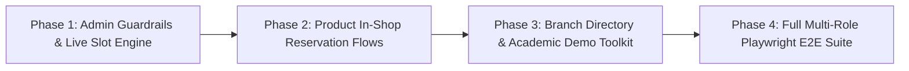

# System Improvement Phased Implementation Roadmap

> **For agentic workers:** Use superpowers:subagent-driven-development or superpowers:executing-plans to implement this plan task-by-task. Steps use checkbox (`- [ ]`) syntax for tracking.

**Goal:** Implement the top improvements derived from the QA and architectural audit: expand the Playwright E2E regression suite to cover all user roles, enable in-shop product reservations (chair add-on & express counter pickup), calculate live "Next Available Slot" on barber cards, complete branch transit guides, harden the admin schedule builder form, and provide an academic defense toolkit.

**Architecture:** ASP.NET Core 8 MVC, Razor Views, Tailwind CSS, Entity Framework Core (PostgreSQL), NodaTime (`Asia/Manila`), Playwright E2E, xUnit. Adheres strictly to `docs/BARBERBOOK_REFERENCE.md` boundaries (`LM-1` in-shop payment, `LM-2` lightweight records, `LM-3` single shop / branch isolation, `BR-03` no double booking).

**Spec:** `docs/superpowers/specs/2026-11-22-system-improvement-brainstorm-and-design.md`

---

## Roadmap Phases Overview



---

## Phase 1: Admin Schedule Form Guardrails & Live Barber Slot Engine (Completed)

### Task 1.1: Admin Schedule Form Client-Side Hardening
**Files to change:**
- `src/BarberBook.Web/Areas/Admin/Views/Schedules/Index.cshtml`
- `tests/BarberBook.Tests/ScheduleEndpointTests.cs`

**Action:**
- [x] Remove Sunday (`<option value="0">Sunday</option>`) from `#whDayOfWeek` or disable it with a badge `Sunday (Shop Closed)`.
- [x] Add `min="09:00" max="18:00"` to `#whStartTime` and `#whEndTime`.
- [x] In `submitAddWorkingHour()`, validate client-side:
  - Day is 1..6 (Mon–Sat).
  - `startTime >= "09:00"` and `endTime <= "18:00"`.
  - `endTime > startTime`.
- [x] Show localized toast on validation error before issuing fetch.

### Task 1.2: Dynamic "Next Available Slot" on Barber Cards
**Files to change:**
- `src/BarberBook.Web/Services/IAvailabilityService.cs`
- `src/BarberBook.Web/Services/AvailabilityService.cs`
- `src/BarberBook.Web/Controllers/HomeController.cs`
- `src/BarberBook.Web/Views/Home/Barbers.cshtml`
- `src/BarberBook.Web/Views/Home/Index.cshtml`
- `tests/BarberBook.Tests/AvailabilityServiceTests.cs`

**Action:**
- [x] Add helper method `GetNextAvailableSlotAsync(barberId)` to `IAvailabilityService` checking today's remaining slots, falling back to tomorrow (or Monday if Sunday).
- [x] Surface `NextAvailableText` (e.g., `"Today 2:30 PM"` or `"Tomorrow 9:00 AM"`) on the barber cards.
- [x] In `Barbers.cshtml` and `Index.cshtml`, replace ops link `"View Profile & Days Off"` with a high-contrast `"Book with [Name]"` button deep-linking to `/book?barberId=@barber.Id`.
- [x] Display an emerald badge `Next: [Time]` next to each barber.

---

## Phase 2: In-Shop Product Reservation & Chair-Side Add-ons (`HW-2`, `LM-1`) — Completed (Option A)

### Task 2.1: Booking Wizard Product Add-on Step (Option A: Chair Add-on Only)
**Files changed:**
- `src/BarberBook.Web/Models/Appointment/AppointmentModels.cs`
- `src/BarberBook.Web/Controllers/BookingController.cs`
- `src/BarberBook.Web/Controllers/AppointmentsApiController.cs`
- `src/BarberBook.Web/Views/Booking/Index.cshtml`
- `tests/BarberBook.Tests/AppointmentBookingTests.cs`

**Action:**
- [x] In `Booking/Index.cshtml`, add Artisan Grooming Add-ons in Step 4 with product photos, stock count, and +/- quantity selectors.
- [x] List in-stock products with increment/decrement buttons (capped at current available stock).
- [x] Display live estimated in-shop settlement breakdown (`Service Price + Product Total = Estimated Grand Total`).
- [x] Persist reserved products and line amounts in appointment notes for chair-side preparation and reception settlement (`LM-1`).
- [x] Tested with `CF4_HW2_CreateAppointment_WithReservedProducts_PersistsReservationInNotes` (278 passing tests).

---

## Phase 3: Branch Directory Enhancement & Academic Demo Toolkit

### Task 3.1: Complete Branch Operating Hours & Transit Information
**Files to change:**
- `src/BarberBook.Data/Seeding/DatabaseSeeder.cs`
- `src/BarberBook.Web/Views/Home/Index.cshtml`
- `src/BarberBook.Web/Areas/Admin/Views/Branches/Index.cshtml`

**Action:**
- [ ] Add `OperatingHours` (`Mon–Sat 9:00 AM – 6:00 PM`) and `LandmarkTransitNote` to Branch entity / seed data for all 5 branches.
- [ ] Add clean SVG district vector markers and direct `"Book at this Branch"` buttons deep-linking to `/book?branchId=@branch.Id`.
- [ ] Label contact numbers clearly with `(Academic Demonstration Landlines · SBIT-3D)`.

### Task 3.2: Academic Oral Defense Toolbar & 1-Click Role Switcher
**Files to change:**
- `src/BarberBook.Web/Views/Shared/_LayoutCustomer.cshtml`
- `src/BarberBook.Web/Views/Shared/_LayoutAdmin.cshtml`
- `src/BarberBook.Web/Controllers/AuthController.cs` (dev-only quick login endpoint)

**Action:**
- [ ] Add a subtle `Demo Mode` ribbon (visible when running in `Development`).
- [ ] Include quick-switch buttons:
  - `[👤 Customer: Juan Dela Cruz]`
  - `[✂️ Barber: Ramon Bautista]`
  - `[🛡️ Admin: Shop Administrator]`
- [ ] Add a `[⚡ Reset Demo Data]` action calling `DatabaseSeeder.SeedAsync()` to restore pristine test states mid-presentation without terminal commands.

---

## Phase 4: Full Multi-Role Playwright E2E Test Suite

### Task 4.1: Customer Lifecycle Spec (`fl-c-customer-lifecycle.spec.ts`)
**Files to create/change:**
- `tests/BarberBook.E2E/tests/fl-c-customer-lifecycle.spec.ts`

**Action:**
- [ ] Test 1: Full registration $\rightarrow$ booking via hero deep-link.
- [ ] Test 2: Log in $\rightarrow$ navigate to "My Appointments" $\rightarrow$ reschedule to another date/slot $\rightarrow$ verify status changes to `pending`.
- [ ] Test 3: Cancel appointment $\rightarrow$ verify slot is restored to public availability (`BR-03`).

### Task 4.2: Barber Workstation Spec (`fl-b-barber-station.spec.ts`)
**Files to create/change:**
- `tests/BarberBook.E2E/tests/fl-b-barber-station.spec.ts`

**Action:**
- [ ] Test 1: Log in as Barber Ramon $\rightarrow$ view today's appointments.
- [ ] Test 2: Confirm a pending appointment $\rightarrow$ complete appointment.
- [ ] Test 3: Verify appointment moves to history $\rightarrow$ verify transaction log shows 50% commission split (`RP-4`).
- [ ] Test 4: Set day off for upcoming date $\rightarrow$ verify customer cannot book Ramon on that date (`BF-3`, `BR-04`).

### Task 4.3: Admin Operations & Financial Oracle Spec (`fl-a-admin-operations.spec.ts`)
**Files to create/change:**
- `tests/BarberBook.E2E/tests/fl-a-admin-operations.spec.ts`

**Action:**
- [ ] Test 1: Log in as Admin $\rightarrow$ approve pending appointments.
- [ ] Test 2: View Daily Sales Report for `2026-09-14` $\rightarrow$ assert exact `₱1,340.00` total sales, matching paper sample oracle (§7.3).
- [ ] Test 3: Record inventory purchase $\rightarrow$ record counter product sale $\rightarrow$ assert stock changes dynamically (`INV-03`).

### Task 4.4: Role Boundary & Security Enforcement Spec (`fl-sec-authorization.spec.ts`)
**Files to create/change:**
- `tests/BarberBook.E2E/tests/fl-sec-authorization.spec.ts`

**Action:**
- [ ] Test 1: Customer role visiting `/admin/*` or `/barber/*` receives HTTP 403 or redirect to login.
- [ ] Test 2: Barber Ramon visiting Dennis's appointments (`/barber/appointments?barberId=2`) is blocked with HTTP 403 (`LM-4`).
- [ ] Test 3: Guest visiting `/book` without session is redirected to `/login?returnUrl=/book` preserving selections.

---

## Verification Plan

```bash
# 1. Backend Build & Tests
dotnet build
dotnet test --no-build

# 2. Complete Playwright E2E Suite
cd tests/BarberBook.E2E
npx playwright test

# 3. Visual Checks
node capture_updated.js
node capture_mobile.js
```
