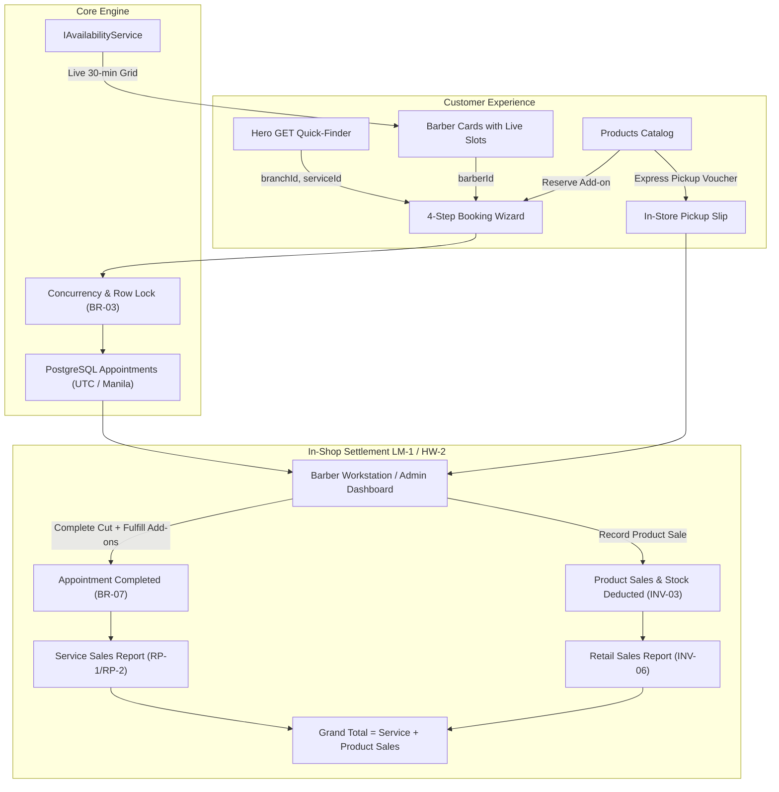

# System Improvement Brainstorm & Architectural Design Spec

**Date:** 2026-11-22  
**System:** BarberBook (Barber Shop Management System · SBIT-3D Group 4)  
**Context:** Synthesis of external QA audit findings, automated test observations, and roadmap for system excellence.  
**Adheres to:** `docs/BARBERBOOK_REFERENCE.md`, `docs/DESIGN_GUIDELINES.md`, `docs/DECISIONS.md`.

---

## 1. Executive Summary & Problem Analysis

Following the resolution of initial ship-blockers (client-side booking wizard crash, corrupted shifts, unbranded studio photography, internal data leaks, and 2x2 services balancing), a comprehensive QA and architectural audit of the entire BarberBook platform revealed six strategic enhancement opportunities:

1. **Front-End Test Coverage Gap:** 276 backend unit/integration tests verified business rules and database constraints, but missed a client-side JavaScript syntax error that completely froze the core booking wizard. End-to-end browser automation must be expanded beyond the basic booking smoke test to cover the full role matrix (Customer, Barber, Admin).
2. **Product Catalog Disconnect (`HW-2`, `LM-1`):** While retail products are showcased with real-time stock and prices, customers cannot take action on them. Under `LM-1`, payments are settled in-shop. The catalog currently requires booking an unrelated haircut just to visit the shop, or leaves products as passive displays.
3. **Static Barber Cards Lacking Decision Data (`CF-3`, `BF-2`):** Barber cards display uniform static text ("Mon-Sat 9:00 AM - 6:00 PM") and internal ops jargon ("View Profile & Days Off"). Customers cannot evaluate who is available next without clicking through the booking wizard.
4. **Branch Presentation Incomplete (`BRN-01`..`BRN-04`):** Locations lack explicit operating hours (only Manila Main has them), physical transit cues/directions, and visual geographic aids.
5. **Admin Workstation Client-Side Guardrails (`HW-2`, `AF-4`):** While backend FluentValidation now rejects invalid shifts (<09:00, >18:00, or Sundays), the Admin Shift Modal still allows selecting "Sunday" and free-form times, creating preventable validation error loops.
6. **Academic Defense & Demonstration Readiness (SBIT-3D Group 4):** Presentation to panelists requires seamless role-switching (Admin $\leftrightarrow$ Barber $\leftrightarrow$ Customer), isolated demo data, and clear academic disclaimers for contact details.

---

## 2. Brainstorming Themes & Solution Architecture

### Theme 1: Comprehensive E2E Playwright Suite & CI Quality Gate
- **Architecture:** Standardize Playwright tests under `tests/BarberBook.E2E/tests/` with modular page object fixtures.
- **Test Scenarios:**
  - `FL-C-1`: Customer registration $\rightarrow$ GET hero quick-booking deep-link $\rightarrow$ 4-step wizard $\rightarrow$ confirmation.
  - `FL-C-2`: Customer appointment management $\rightarrow$ reschedule to a new slot $\rightarrow$ verify pending status $\rightarrow$ cancel appointment.
  - `FL-B-1`: Barber station $\rightarrow$ login as Ramon $\rightarrow$ view today's queue $\rightarrow$ confirm appointment $\rightarrow$ complete cut $\rightarrow$ verify transaction log & 50% commission calculation.
  - `FL-B-2`: Barber availability $\rightarrow$ add day off $\rightarrow$ verify slot disappears from customer availability in real time (`BR-04`).
  - `FL-A-1`: Admin operations $\rightarrow$ approve pending bookings $\rightarrow$ create walk-in appointment $\rightarrow$ view daily sales report (`₱1,340.00` oracle match).
  - `FL-A-2`: Admin inventory & product sales $\rightarrow$ record supplier purchase (stock +) $\rightarrow$ record counter sale (stock -) $\rightarrow$ verify grand total reporting separation (`INV-06`).
  - `FL-SEC-1`: Server authorization & role boundaries $\rightarrow$ assert customer blocked from `/admin/*` and `/barber/*` $\rightarrow$ assert barber blocked from cross-barber URLs.

### Theme 2: In-Shop Product Reservation & Unified Chair-Side Checkout (`HW-2`, `LM-1`, `INV-04`)
- **Mental Model:** Honor `LM-1` (no online card payments; in-shop cash/direct settlement only) while giving the product catalog purpose:
  - **Pathway A (Chair Session Add-on):** Within the customer booking wizard (Step 3 or Step 4 review), offer an optional "Artisan Grooming Add-ons" accordion. Customers can select up to 3 products (e.g., Pomade + Beard Oil). The reservation is attached to the `Appointment` (`AppointmentId` already exists on `ProductSale` entity). Upon completing the service in the shop, the barber/cashier marks the appointment completed and records the bundled product sale with one tap.
  - **Pathway B (Express In-Shop Pickup Slip):** On `/products`, add "Reserve for In-Shop Pickup". Customer selects product and quantity, inputs name and phone, and receives a digital pickup voucher (`BB-PK-YYYYMMDD-XXXX`). Stock is soft-reserved or flagged. On the Admin dashboard, an "Express Counter Pickups" queue lets the cashier fulfill the sale when the customer arrives.

### Theme 3: Real-Time "Next Available Slot" on Barber Cards (`CF-3`, `BR-04`)
- **Engine:** Leverage existing `IAvailabilityService.GetAvailableSlotDetailsAsync(barberId, defaultServiceId, today)`.
- **Logic:**
  - Check remaining slots for today (Asia/Manila time).
  - If today has slots: display `Next available: Today 2:30 PM` (styled with a live emerald pulse).
  - If today is fully booked or past 18:00: query tomorrow (or Monday if tomorrow is Sunday); display `Next available: Tomorrow 9:30 AM` or `Next available: Mon 9:00 AM`.
  - Replace ops link `"View Profile & Days Off"` with `"Book with [Name]"` pre-selecting the barber in the booking wizard (`/book?barberId=...`).

### Theme 4: High-Conversion Branch Directory & Transit Guides (`BRN-01`..`BRN-04`)
- **Metadata Enhancement:** Standardize branch metadata across all locations:
  - Operating Hours: `Mon–Sat 9:00 AM – 6:00 PM · Closed Sundays`.
  - Transit Directions: Landmark cross-streets (e.g., *"2nd Floor High Street South, across amphitheater"*).
  - Interactive/Visual Map Cue: Clean vector SVG floor/district map badge with Google Maps search link.
  - Direct Booking Deep-Link: `"Book at this Branch"` passing `branchId` to `/book?branchId=...`.

### Theme 5: Admin Workstation Validation Guardrails (`AF-4`, `HW-2`)
- **Frontend Form Hardening:**
  - Remove Sunday (`value="0"`) from the Shift Modal day-of-week select, or disable it with a clear `"(Closed)"` annotation.
  - Add `min="09:00"` and `max="18:00"` to `#whStartTime` and `#whEndTime` inputs.
  - Add client-side validation logic preventing `endTime <= startTime` before sending the fetch request.
  - Surface friendly toast errors when server validation returns 400.

### Theme 6: Academic Defense & Demonstration Toolkit (SBIT-3D Group 4)
- **Features for Live Presentation:**
  - **Demo Quick Switcher:** Subtle top drawer or floating demo toolbar (active only in `Development` or when `?demo=1` is enabled) allowing instant 1-click login as:
    1. *Customer:* Juan Dela Cruz
    2. *Barber:* Ramon Bautista (Master Barber)
    3. *Admin:* Shop Owner / Head Administrator
  - **1-Click Seed Reset:** Admin tool to reset the database back to clean paper-oracle state (`₱1,340.00` daily sales, Ramon 9-6) without restarting the server.
  - **Academic Disclaimer Banner:** Subtle notice in footer indicating contact numbers and addresses are simulated academic demonstration data for thesis defense.

---

## 3. Architecture & Data Flow

---

## 4. Requirement Traceability Matrix

| Proposed Improvement | Requirement IDs | Source Anchor | Primary Benefit |
|---|---|---|---|
| E2E Playwright Suite Expansion | `T-01`..`T-22`, `FL-C`, `FL-B`, `FL-A` | Proposal §15, Audit | Eliminates silent front-end regressions across all roles |
| Chair-Side Product Reservation | `HW-2`, `LM-1`, `LM-2`, `INV-04`, `CF-4` | Cover [H], Audit | Bridges retail catalog with in-shop settlement |
| Express Counter Pickup Voucher | `HW-2`, `LM-1`, `INV-03`, `INV-04` | Cover [H], Audit | Enables standalone product sales without forcing haircut |
| Live "Next Available" Slot Calculation | `CF-3`, `BR-04`, `OB-2` | Proposal §6.2, Audit | Solves customer choice paralysis with dynamic data |
| Branch Directory & Transit Guide | `BRN-01`..`BRN-04`, `SC-2` | Architecture, Audit | Professional local presence and multi-branch clarity |
| Admin Schedule Modal Guardrails | `AF-4`, `HW-2`, `BR-03` | Proposal §6.3, Audit | Prevents bad shift data entry at form level |
| Defense Demo Switcher & Reset | `SBIT-3D`, `DEMO_SCRIPT.md` | Academic Proposal | Guarantees flawless oral defense execution |
